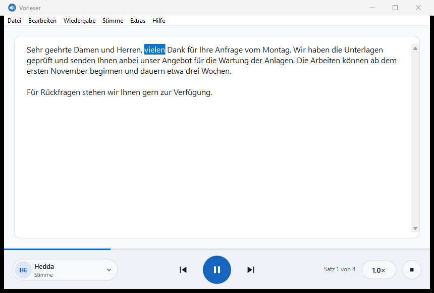
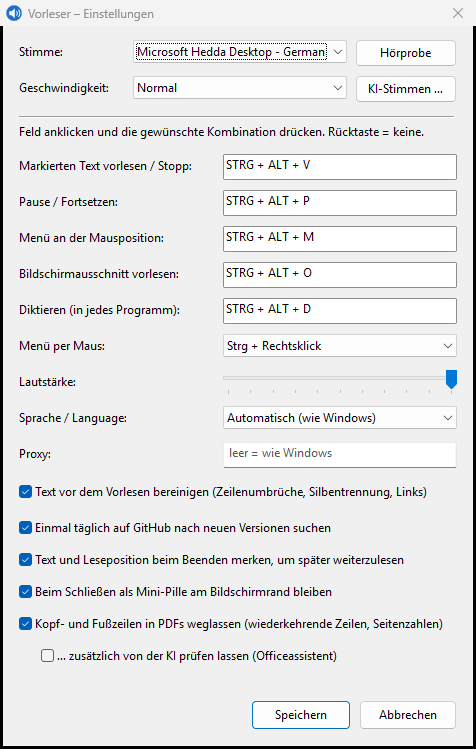

# Vorleser

[English version](README.en.md)

Vorleser liest markierten Text in jedem Windows-Programm vor: Text markieren, **Strg+Alt+V** drücken, zuhören. Das Programm sitzt als kleines Symbol im Infobereich, braucht kaum Speicher und nutzt die Stimmen, die Windows schon mitbringt.



## Herunterladen

Die aktuelle Version steht unter [Releases](https://github.com/Beseco/beseco-vorleser/releases/latest):

- **Vorleser-Setup-x.y.z.exe**: Installer, braucht keine Administratorrechte
- **Vorleser-x.y.z-portable.zip**: einzelne EXE zum Entpacken, ohne Installation

Der Installer ist nicht signiert. Windows zeigt deshalb beim Start „Der Computer wurde durch Windows geschützt“. Mit „Weitere Informationen“ und „Trotzdem ausführen“ geht es weiter.

Voraussetzung ist Windows 10 oder 11 (64 Bit).

## Bedienung

| Aktion | Standard |
|---|---|
| Markierten Text vorlesen, erneut drücken zum Stoppen | Strg+Alt+V |
| Pause und Fortsetzen | Strg+Alt+P |
| Vorleser-Menü an der Mausposition | Strg+Rechtsklick oder Strg+Alt+M |
| Fenster öffnen | Linksklick auf das Symbol im Infobereich |
| Menü mit Stimme, Geschwindigkeit, Einstellungen | Rechtsklick auf das Symbol |

Alle Tastenkombinationen lassen sich unter „Einstellungen“ ändern.

Ein eigener Eintrag im normalen Rechtsklick-Menü fremder Programme ist unter Windows technisch nicht möglich. Strg+Rechtsklick ist der Ersatz dafür: Statt des Menüs der Anwendung erscheint das Vorleser-Menü.

## Funktionen

- **Systemweit:** funktioniert in Browser, Office, PDF-Readern, Editoren und den meisten anderen Programmen
- **Fenster zum Einfügen:** Text hineinkopieren, Stimmen per Hörprobe vergleichen
- **Mitlesen:** das gerade gesprochene Wort wird im Fenster markiert
- **Immer im Vordergrund:** das Fenster bleibt auf Wunsch über anderen Fenstern
- **Stimmen:** alle installierten Windows-Stimmen, nach Sprache gruppiert
- **Textbereinigung:** fügt umbrochene PDF-Zeilen zusammen, hebt Silbentrennung auf, kürzt Links
- **Audio-Export:** Text als WAV-Datei speichern
- **Autostart:** auf Wunsch mit Windows starten
- **Deutsch und Englisch:** die Oberfläche folgt der Sprache von Windows und lässt sich in den Einstellungen umstellen



## Stimmen

Vorleser verwendet die in Windows installierten Stimmen. Weitere lassen sich in den Windows-Einstellungen unter „Zeit und Sprache → Spracherkennung → Stimmen hinzufügen“ nachladen.

### KI-Stimmen

Deutlich natürlicher klingen die KI-Stimmen, die sich im Vorleser-Fenster über **„KI-Stimmen …“** mit einem Klick laden lassen. Sie beruhen auf [Piper](https://github.com/rhasspy/piper) und laufen nach dem einmaligen Download ohne Internet nur auf dem eigenen Rechner.

| Stimme | Sprache | Download | Lizenz der Trainingsdaten |
|---|---|---|---|
| Thorsten | Deutsch, männlich | 63 MB | CC0 ([Thorsten-Voice](https://github.com/thorstenMueller/Thorsten-Voice)) |
| Thorsten HD | Deutsch, männlich, höchste Qualität | 114 MB | CC0 |
| Kerstin | Deutsch, weiblich | 63 MB | CC0 |
| Linda | Englisch, weiblich, höchste Qualität | 114 MB | gemeinfrei (LJ Speech) |
| Kristin | Englisch, weiblich | 64 MB | gemeinfrei (LibriVox) |

Beim ersten Download kommt einmalig die Sprachausgabe Piper hinzu (22 MB). Alle Dateien werden über eine fest hinterlegte SHA-256-Prüfsumme kontrolliert und unter `%LOCALAPPDATA%\Vorleser\piper` abgelegt; die Deinstallation entfernt sie wieder. Beim Mitlesen markiert Vorleser mit KI-Stimmen den ganzen Satz statt des einzelnen Wortes.

Online-Stimmen, die manche Zusatzprogramme in Windows einbinden (erkennbar am Zusatz „Online“ im Namen), zeigt Vorleser nicht an: Sie hängen von einem fremden Dienst ab, brechen je nach Netz ab und schicken den Text an ihren Anbieter.

## Datenschutz

Vorleser sammelt keine Daten. Ins Internet geht Vorleser nur in zwei Fällen: bei der Suche nach neuen Versionen (höchstens einmal am Tag eine Anfrage an GitHub, ohne Text, Einstellungen oder Kennung des Rechners; in den Einstellungen abschaltbar) und wenn du selbst eine KI-Stimme herunterlädst (von github.com und huggingface.co). Der Text wird ausschließlich auf dem eigenen Rechner verarbeitet.

Zum Auslesen der Markierung nutzt Vorleser die Bedienungshilfen-Schnittstelle von Windows. Wo das nicht geht, kopiert es den Text kurz über die Zwischenablage und stellt deren vorherigen Inhalt wieder her.

Einstellungen liegen in `%APPDATA%\Vorleser\settings.ini`.

## Bekannte Grenzen

- In Fenstern, die mit Administratorrechten laufen, kann Vorleser die Markierung nicht auslesen.
- Kopiergeschützte PDFs und Passwortfelder geben keinen Text heraus.
- Der beim Auslesen kopierte Text kann im Zwischenablageverlauf (Win+V) erscheinen.

## Selbst bauen

Vorleser ist in Rust geschrieben und hängt nur vom `windows`-Crate ab.

```powershell
# Einmalig: Rust, MinGW-w64 (liefert dlltool und windres) und für den Installer Inno Setup
winget install -e --id Rustlang.Rustup
rustup set default-host x86_64-pc-windows-gnu
winget install -e --id BrechtSanders.WinLibs.POSIX.UCRT --scope user
winget install -e --id JRSoftware.InnoSetup

# Bauen und testen
.\cargo.ps1 test
.\cargo.ps1 build --release

# Installer und portable ZIP nach dist\
powershell -ExecutionPolicy Bypass -File release.ps1
```

Die Tests der Sprachausgabe sprechen stumm über das Standard-Audiogerät und brauchen mindestens eine installierte Windows-Stimme.

Geplante Erweiterungen stehen in [TODO.md](TODO.md), Änderungen je Version in [CHANGELOG.md](CHANGELOG.md).

## Lizenz und Kontakt

Vorleser ist freie Software unter der [GNU General Public License, Version 3](LICENSE).

Entwickelt von Florian Beubl, [beseco – Beubl IT Systems](https://beseco.com), Freising. Fehler und Wünsche bitte als [Issue](https://github.com/Beseco/beseco-vorleser/issues) melden.
