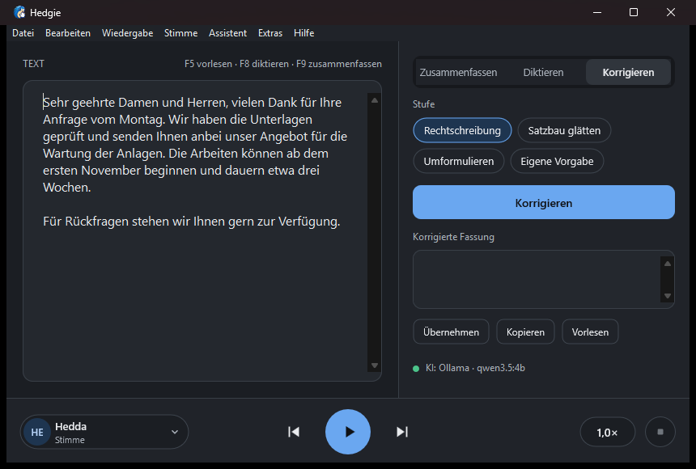

# Hedgie


[English version](README.en.md)

**Hedgie liest vor, schreibt mit und fasst zusammen.** Bis Version 0.5 hieß das Programm „Hedgie“.

Hedgie liest markierten Text in jedem Windows-Programm vor: Text markieren, **Strg+Alt+V** drücken, zuhören. Das Programm sitzt als kleines Symbol im Infobereich, braucht kaum Speicher und nutzt die Stimmen, die Windows schon mitbringt.


## Herunterladen

Die aktuelle Version steht unter [Releases](https://github.com/Beseco/beseco-vorleser/releases/latest):

- **Hedgie-Setup-x.y.z.exe**: Installer, braucht keine Administratorrechte
- **Hedgie-x.y.z-portable.zip**: einzelne EXE zum Entpacken, ohne Installation

Der Installer ist nicht signiert. Windows zeigt deshalb beim Start „Der Computer wurde durch Windows geschützt“. Mit „Weitere Informationen“ und „Trotzdem ausführen“ geht es weiter.

Voraussetzung ist Windows 10 oder 11 (64 Bit).

## Bedienung

| Aktion | Standard |
|---|---|
| Markierten Text vorlesen, erneut drücken zum Stoppen | Strg+Alt+V |
| Pause und Fortsetzen | Strg+Alt+P |
| Hedgie-Menü an der Mausposition | Strg+Rechtsklick oder Strg+Alt+M |
| Text vom Bildschirm erkennen und vorlesen (Rahmen aufziehen) | Strg+Alt+O |
| Diktieren in das Programm im Vordergrund (mit Officeassistent) | Strg+Alt+D |
| Fenster öffnen | Linksklick auf das Symbol im Infobereich |
| Menü mit Stimme, Geschwindigkeit, Einstellungen | Rechtsklick auf das Symbol |

Alle Tastenkombinationen lassen sich unter „Einstellungen“ ändern.

Ein eigener Eintrag im normalen Rechtsklick-Menü fremder Programme ist unter Windows technisch nicht möglich. Strg+Rechtsklick ist der Ersatz dafür: Statt des Menüs der Anwendung erscheint das Hedgie-Menü.

## Funktionen

- **Systemweit:** funktioniert in Browser, Office, PDF-Readern, Editoren und den meisten anderen Programmen
- **Fenster zum Einfügen:** Text hineinkopieren und vorlesen; Stimme und Geschwindigkeit im Menü „Stimme“ oder unter Extras → Einstellungen (mit Hörprobe)
- **Dateien vorlesen:** Word (DOCX), OpenDocument (ODT), RTF, PDF, EPUB, HTML, Textdateien und Bilder öffnen, über Datei → Öffnen, durch Hineinziehen ins Fenster oder „Öffnen mit“ im Explorer
- **PDFs:** mit Textebene direkt und zeichengenau gelesen, gescannte Seiten per Texterkennung; Kopf- und Fußzeilen sowie Seitenzahlen werden übersprungen (auf Wunsch zusätzlich von der KI geprüft, bei Cloud-Anbietern nur nach Rückfrage)
- **Texterkennung (OCR):** Text, der sich nicht markieren lässt, etwa in Bildern, gescannten PDFs oder Programmen ohne Textauswahl, per Rahmen auf dem Bildschirm erkennen und vorlesen. Dafür nutzt Hedgie die Texterkennung von Windows, offline und ohne Zusatzsoftware.
- **Anleitung zum Anhören:** erscheint beim ersten Start im Textfeld und lässt sich unter Hilfe jederzeit anzeigen oder vorlesen
- **Mitlesen:** das gerade gesprochene Wort wird im Fenster markiert
- **Immer im Vordergrund:** das Fenster bleibt auf Wunsch über anderen Fenstern (Extras)
- **Stimmen:** alle installierten Windows-Stimmen, nach Sprache gruppiert; englischer Text wird automatisch mit einer englischen Stimme gelesen, deutscher mit einer deutschen (abschaltbar)
- **Textbereinigung:** fügt umbrochene PDF-Zeilen zusammen, hebt Silbentrennung auf, kürzt Links
- **Audio-Export:** Text als MP3- oder WAV-Datei speichern
- **Autostart:** auf Wunsch mit Windows starten
- **Navigation und Weiterlesen:** Alt+← / Alt+→ springt satzweise, F5 liest ab der Schreibmarke, nach Stopp und nach einem Neustart geht es an derselben Stelle weiter
- **Menüleiste und Tastenkürzel:** F5 Vorlesen, F6 Pause, F7 Stopp, Strg+O Textdatei öffnen (oder ins Fenster ziehen), Strg+S als WAV speichern
- **Mehrsprachig:** Deutsch und Englisch eingebaut, weitere Sprachen über einfache Sprachdateien ([Anleitung zum Übersetzen](lang/README.md)); die Oberfläche folgt der Sprache von Windows und lässt sich unter Extras → Sprache umstellen


## Stimmen

Hedgie verwendet die in Windows installierten Stimmen. Weitere lassen sich in den Windows-Einstellungen unter „Zeit und Sprache → Spracherkennung → Stimmen hinzufügen“ nachladen.

### KI-Stimmen

Deutlich natürlicher klingen die KI-Stimmen, die sich über **Stimme → KI-Stimmen …** (oder in den Einstellungen) mit einem Klick laden lassen. Sie beruhen auf [Piper](https://github.com/rhasspy/piper) und laufen nach dem einmaligen Download ohne Internet nur auf dem eigenen Rechner.

| Stimme | Sprache | Download | Lizenz der Trainingsdaten |
|---|---|---|---|
| Thorsten | Deutsch, männlich | 63 MB | CC0 ([Thorsten-Voice](https://github.com/thorstenMueller/Thorsten-Voice)) |
| Thorsten HD | Deutsch, männlich, höchste Qualität | 114 MB | CC0 |
| Kerstin | Deutsch, weiblich | 63 MB | CC0 |
| Linda | Englisch, weiblich, höchste Qualität | 114 MB | gemeinfrei (LJ Speech) |
| Kristin | Englisch, weiblich | 64 MB | gemeinfrei (LibriVox) |

Beim ersten Download kommt einmalig die Sprachausgabe Piper hinzu (22 MB). Alle Dateien werden über eine fest hinterlegte SHA-256-Prüfsumme kontrolliert und unter `%LOCALAPPDATA%\Vorleser\piper` abgelegt; die Deinstallation entfernt sie wieder. Beim Mitlesen markiert Hedgie mit KI-Stimmen den ganzen Satz statt des einzelnen Wortes.

Online-Stimmen, die manche Zusatzprogramme in Windows einbinden (erkennbar am Zusatz „Online“ im Namen), zeigt Hedgie nicht an: Sie hängen von einem fremden Dienst ab, brechen je nach Netz ab und schicken den Text an ihren Anbieter.

## Beseco Officeassistent (optional)

Wer mehr möchte, schaltet unter **Extras → Beseco Officeassistent** (oder schon im Installer) die KI-Funktionen ein. Ausgeschaltet bleibt Hedgie genau so einfach wie bisher; es braucht keinen Schlüssel und kein Konto.

Eingeschaltet teilt sich das Fenster: links der Text, rechts das Ergebnis der KI. **Zusammenfassen** (F9) fasst den markierten oder ganzen Text kurz, in Stichpunkten oder ausführlich zusammen, und die Zusammenfassung wird gleich vorgelesen (Umschalt+F9 liest sie erneut).

Am einfachsten richtet der **Einrichtungsassistent** die KI ein (**Assistent → KI einrichten**; er erscheint auch von selbst, wenn noch keine KI eingerichtet ist). Er stellt eine Frage – wo soll die KI laufen? – und erledigt den Rest:

- **Auf diesem PC:** Ist Ollama nicht installiert, lädt der Assistent es herunter (ca. 1,7 GB) und installiert es für das eigene Benutzerkonto, ohne Administratorrechte. Fehlt ein Sprachmodell, lädt er eines passend zum Rechner (qwen3.5:4b, mit starker Grafikkarte gemma3:12b).
- **Ollama-Server im Firmennetz:** Name des Servers eintragen, z. B. `ki-server`; Adresse und Port ergänzt der Assistent.
- **Cloud-Anbieter mit API-Schlüssel:** Adresse (IONOS ist vorbelegt) und Schlüssel eintragen.
- **Ohne KI:** nur Vorlesen und Diktieren.

Der Assistent sucht ein geeignetes Modell aus, schickt einen Probe-Auftrag und speichert alles. Solange keine KI eingerichtet ist, sind Zusammenfassen und Korrigieren grau.

Alles Weitere stellst du unter **Assistent → KI-Einstellungen und KI-Check** ein:

| Anbieter | Beispiel | Datenschutz |
|---|---|---|
| Eigener Server oder dieser PC (Ollama) | `http://ki-server:11434` | Text bleibt im eigenen Netz |
| Cloud-Anbieter mit OpenAI-kompatibler Schnittstelle | IONOS AI Model Hub: `https://openai.inference.de-txl.ionos.com/v1`, außerdem Mistral, OpenAI u. a. | Text geht zur Verarbeitung an den Anbieter |

Der **KI-Check** im selben Fenster zeigt, was der eigene Rechner schafft (Prozessor, Arbeitsspeicher, Grafikkarte) und empfiehlt lokal, eigenen Server oder Cloud. „Verbindung testen“ prüft Adresse, Schlüssel und Modell mit einem kurzen Probe-Auftrag. Der Schlüssel wird mit dem Windows-Konto verschlüsselt gespeichert (DPAPI).



**Diktieren** (F8 oder „Diktieren“): Du sprichst, und der Text erscheint nach jeder kurzen Pause an der Schreibmarke im linken Feld. Mit **Strg+Alt+D** diktierst du in jedes andere Programm, etwa Word oder Outlook: Der Text erscheint dort, wo die Schreibmarke steht, und eine kleine Leiste unten am Bildschirm zeigt Pegel und Zustand. Getippt wird nur in das Programm, in dem das Diktat begonnen hat; wechselst du zwischendurch, wartet der Text. „Korrigieren“ in der Leiste ersetzt den eben diktierten Text dort durch die korrigierte Fassung. Das Mikrofon wählst du unter **Assistent → Mikrofon**.

**Aufnahme zu Protokoll:** Eine Besprechungsaufnahme (MP3, M4A, WAV, WMA, FLAC oder ein MP4-Video) über **Assistent → Aufnahme zu Protokoll …** öffnen oder ins Fenster ziehen. Hedgie schreibt sie auf dem eigenen Rechner ab (links, mit Zeitmarken) und erstellt mit der eingerichteten KI rechts das Protokoll: Teilnehmer, Themen, Beschlüsse, Aufgaben und offene Punkte. Eine Stunde Aufnahme dauert ohne Grafikkarte je nach Modell etwa 5 bis 20 Minuten; der Fortschritt steht im Fenstertitel. Wer spricht, erkennt die Abschrift nicht.

**Mini-Pille:** Ist das Fenster zu oder minimiert, bleibt unten in der Mitte des Bildschirms, auf dem du gerade arbeitest, eine kleine Pille mit blauem Punkt, immer im Vordergrund. Mit der Maus lässt sie sich an eine andere Stelle ziehen (Rechtsklick → Position zurücksetzen). Fährst du mit der Maus darauf, zeigt er zwei Knöpfe: das Mikrofon diktiert in das Programm im Vordergrund, der sprechende Kopf liest dort markierten Text vor. Wer lieber nur das Symbol im Infobereich möchte, schaltet die Pille unter **Extras → Mini-Pille am Bildschirmrand** oder in den Einstellungen ab. Die Spracherkennung (Whisper) läuft vollständig auf dem eigenen Rechner, ohne KI-Anbieter und ohne Internet; nur das Modell wird einmalig unter **Assistent → Diktieren einrichten** heruntergeladen (schnell 148 MB, genau 488 MB, sehr genau 574 MB; von github.com und huggingface.co).

**Korrigieren** (Umschalt+F8) überarbeitet den Text mit der eingestellten KI in der gewählten Stufe: nur Rechtschreibung und Zeichensetzung, Satzbau glätten, sauber umformulieren oder nach eigener Vorgabe (in den KI-Einstellungen, z. B. „als freundliche E-Mail formulieren“). Die korrigierte Fassung erscheint rechts, das Diktat links bleibt unverändert. Nach einem Diktat wird automatisch korrigiert, wenn eine KI eingerichtet ist.

Geplant sind außerdem Protokolle aus Audiodateien und ein Datenschutz-Modus, der personenbezogene Daten vor dem Senden ersetzt (siehe [TODO.md](TODO.md)).

## Datenschutz

Hedgie sammelt keine Daten. Ins Internet geht Hedgie nur in zwei Fällen: bei der Suche nach neuen Versionen (höchstens einmal am Tag eine Anfrage an GitHub, ohne Text, Einstellungen oder Kennung des Rechners; in den Einstellungen abschaltbar) wenn du selbst eine KI-Stimme oder ein Modell für das Diktieren herunterlädst (von github.com und huggingface.co) und, nur bei eingeschaltetem Officeassistenten, an den von dir gewählten KI-Anbieter, wenn du eine KI-Funktion auslöst. Der Text wird ausschließlich auf dem eigenen Rechner verarbeitet.

Zum Auslesen der Markierung nutzt Hedgie die Bedienungshilfen-Schnittstelle von Windows. Wo das nicht geht, kopiert es den Text kurz über die Zwischenablage und stellt deren vorherigen Inhalt wieder her.

Einstellungen liegen in `%APPDATA%\Vorleser\settings.ini`. Damit es später an derselben Stelle weitergeht, merkt sich Hedgie beim Beenden den Text des Fensters in `%APPDATA%\Vorleser\letzter-text.txt`; das lässt sich in den Einstellungen abschalten, die Datei wird dann gelöscht.

### Im Firmennetz

Hedgie nutzt die Proxy-Einstellungen von Windows, auch eine automatische Konfiguration über `wpad.dat`. Verlangt der Proxy eine Anmeldung, meldet sich Hedgie mit dem Windows-Konto an. Greift das nicht, lässt sich unter Extras → Einstellungen → Proxy die Adresse der `wpad.dat` (z. B. `http://wpad/wpad.dat`) oder ein fester Proxy (`proxy.firma.local:8080`) eintragen. Ohne Internet funktioniert alles außer Update-Suche und Download der KI-Stimmen.

## Bekannte Grenzen

- In Fenstern, die mit Administratorrechten laufen, kann Hedgie die Markierung nicht auslesen.
- Passwortfelder geben keinen Text heraus. PDFs liest Hedgie über die Texterkennung; bei sehr kleiner Schrift oder schlechten Scans kann sie einzelne Wörter verfehlen.
- Das alte Word-Format (.doc) wird nicht unterstützt, bitte als .docx speichern.
- Der beim Auslesen kopierte Text kann im Zwischenablageverlauf (Win+V) erscheinen.

## Selbst bauen

Hedgie ist in Rust geschrieben und hängt nur vom `windows`-Crate ab.

```powershell
# Einmalig: Rust, MinGW-w64 (liefert dlltool und windres) und für den Installer Inno Setup
winget install -e --id Rustlang.Rustup
rustup set default-host x86_64-pc-windows-gnu
winget install -e --id BrechtSanders.WinLibs.POSIX.UCRT --scope user
winget install -e --id JRSoftware.InnoSetup

# Bauen und testen
.\cargo.ps1 test
.\cargo.ps1 build --release

# Installer und portable ZIP nach dist\
powershell -ExecutionPolicy Bypass -File release.ps1
```

Die Tests der Sprachausgabe sprechen stumm über das Standard-Audiogerät und brauchen mindestens eine installierte Windows-Stimme.

Geplante Erweiterungen stehen in [TODO.md](TODO.md), Änderungen je Version in [CHANGELOG.md](CHANGELOG.md).

## Lizenz und Kontakt

Hedgie ist freie Software unter der [GNU General Public License, Version 3](LICENSE).

Entwickelt von Florian Beubl, [beseco – Beubl IT Systems](https://beseco.com), Freising. Fehler und Wünsche bitte als [Issue](https://github.com/Beseco/beseco-vorleser/issues) melden.
